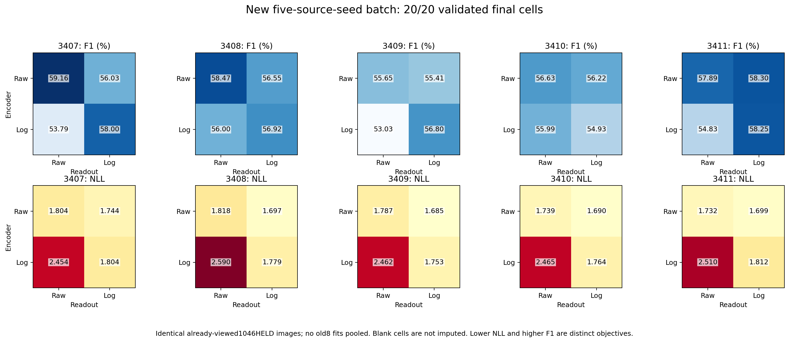
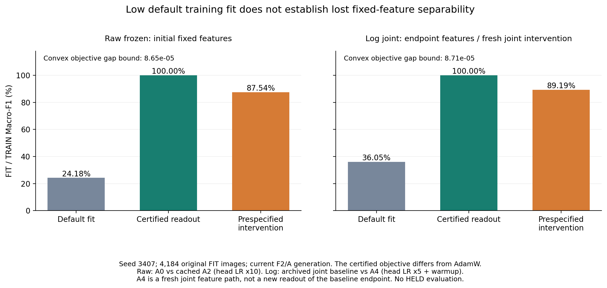

# Plant SPD：从几何收益到机制取证的完整研究链

**研究对象：SPD协方差表示、Log-Euclidean几何与二阶视觉识别。**  
**当前工作题目：Before Comparing Geometry: Auditing Optimization and Readout in Covariance Pooling**  
**中文：比较几何之前：协方差池化中的优化与读出审计。**

> **当一个模型依靠通道关系识别图像时，几何比较究竟改变了什么？我们看到的分数差异，有多少可以归于表示，又有多少取决于优化、概率尺度和读出工具？**

本研究从一个具体的视觉直觉出发：病斑纹理、形态与局部结构可能体现在特征通道的共同变化中。我们用协方差描述这种关系，用SPD空间中的矩阵映射比较这种关系，再以配对训练、数学推导、认证读出与预注册干预逐层检验其作用。**SPD与黎曼几何贯穿研究对象、模型设计和数学分析；审计流程使几何收益的解释变得可检验。**

研究中有两组值得同时面对的结果：固定原型头端到端配方下，Log在10个Raw/Log配对中全部取得正的HELD F1差，平均约 **+2.10pp**；换成等头族默认配方后，又出现 **Raw joint约99.55%、Log joint约34.12%、冻结双臂约24%的TRAIN拟合断裂**。对应固定特征经认证仿射读出可以达到TRAIN100%，头部配方干预又能显著恢复拟合。贯穿这些结果的问题是：**如何把几何表示的能力、读出工具的能力与有限训练的结果分开测量？**

这份README按研究推理顺序展开，包含模型、已完成实验、严格推导、代码与工件、可入论文的步骤、图表和运行入口。引用的旧工作不被抹去；不同证据代次和未完成的验证分开标注。原数据、权重、协议和科学源码保持原字节，本机绝对路径保留。

## 阅读入口

| 需要什么 | 文件 |
|---|---|
| 完整问题与证据链 | 本README；[论文叙事](00_paper_story/PAPER_STORY_ZH.md) |
| 按章节写论文 | [正文大纲](00_paper_story/MANUSCRIPT_OUTLINE.md) · [英文摘要](00_paper_story/ABSTRACT_EN.md) |
| 数学推导、证明与代码核对 | 本文第四节；[数学—证据对应表](00_paper_story/MATHEMATICS_AND_EVIDENCE.md)；[完整标准推导](09_scientific_supplement_v1/math/MATHEMATICAL_APPENDIX.md) |
| 每个主张与数字的依据 | [声明台账](00_paper_story/CLAIMS_LEDGER.md) · [工件登记](12_evidence_reconciliation_v1/EVIDENCE_REGISTER_V1.md) |
| 图、英文图注和待做项目 | [当前图件](04_figures/CURRENT_PAPER_FIGURES.md) · [图表计划](05_table_figure_plan/FIGURE_TABLE_PLAN.md) |
| 参考文献、PDF与BibTeX | [文献库](13_references/README.md) · [用途与阅读范围](13_references/REFERENCES.md) · [BibTeX](13_references/references.bib) |
| 复现实验 | [运行说明](07_reproducibility/REPRODUCIBILITY.md) · [五种子交叉读出](07_reproducibility/CROSS_READOUT_REPRODUCTION.md) |

## 一、为什么从SPD与黎曼几何出发

### 1. 从“通道强度”走向“通道关系”

若仅平均池化，模型得到各通道平均响应；协方差还记录哪些通道共同增强、共同减弱或相互变化。因此，即便平均响应接近，纹理及形态仍可能通过通道关系区分。

一个只说明数学可能性的例子是

$$
A=\begin{pmatrix}1&r\\r&1\end{pmatrix},\qquad
B=\begin{pmatrix}1&-r\\-r&1\end{pmatrix},\quad 0<r<1.
$$

两者对角相同、特征值集合也相同，却有不同的通道关系。这说明二阶结构与特征方向值得保留。它不替代真实图像上的判别性验证，也不能据此断言病害信号“主要”存在于协方差中。

本研究的任务假设为：**二阶关系可能提供判别信息；不同矩阵映射会改变这种信息的比较方式及训练路径。** 该假设落实为实际Raw/Log/Sqrt模型和受控对照，而不以理论名称直接宣布收益。

### 2. 实际模型怎样构造SPD

共享ImageNet初始化ResNet18至layer3；固定QR投影把256通道映射到32维。每个图像视图有空间token矩阵 $F_v\in\mathbb{R}^{n_v\times32}$，定义

$$
\widehat C_v=\frac{(F_v-\mathbf{1}\bar f_v^\top)^\top(F_v-\mathbf{1}\bar f_v^\top)}{n_v-1},
\qquad
C_v=0.95\widehat C_v+0.05\frac{\operatorname{tr}\widehat C_v}{32}I+10^{-4}I.
$$

原型为 $P_{vc}=B_{vc}B_{vc}^{\top}+10^{-4}I$。在精确算术下，输入和原型均正定。Log实现检查有限谱与正谱，训练过程另检查非有限损失、梯度和参数；数学性质与浮点实现分别验收。

两个输入是整图中心视图与中央半幅视图，提供不同空间粒度；它们**没有专家确认的病斑ROI含义**。推理不输入GT掩码。实际计算见[E01 runner](02_experiments/E01_paired_training/source/runner_v2.py)的 `PairedGeometryModel.forward`、`projection_qr` 与 `stable_logm`。

### 3. 三种映射比较什么

$$
\phi_{\rm Raw}(C)=C,\quad \phi_{\rm Log}(C)=\log C,\quad
\phi_{\rm Sqrt}(C)=C^{1/2},\qquad
d_{\phi}(C,P)^2=\Vert \phi(C)-\phi(P)\Vert _F^2.
$$

Raw同样使用完整协方差；它不是RGB基线或一阶池化。对称矩阵的 `svec` 对非对角项乘 $\sqrt2$，可保留Frobenius内积和全部独立元素。Raw与Log的区别在比较结构及敏感度，而非“展平丢了信息或破坏拓扑”。

Log-Euclidean有明确的黎曼含义。矩阵对数是SPD到对称矩阵空间的光滑双射，定义拉回度量

$$
g_C(H,K)=\langle D\log_C[H],D\log_C[K]\rangle_F,
\qquad d_{LE}(A,B)=\Vert \log A-\log B\Vert _F.
$$

对应测地线为 $\exp[(1-t)\log A+t\log B]$。这使原型比较具有清楚的几何对象和距离定义。[Log-Euclidean原始文献](https://www-sop.inria.fr/asclepios/Publications/Arsigny/arsigny_mrm_2006.pdf)是背景依据；本研究不主张发明这一度量。Log-Euclidean与AIRM是不同几何，不把它写成一般仿射不变，也不据此声称发现数据的内在曲率。

### 4. 实际比较如何控制变量

| 项目 | 实际设置与需要保留的区别 |
|---|---|
| 数据与指标 | 原5230张TRAIN池、69类分类；每个划分4184 FIT/1046 HELD。主指标固定69类Macro-F1，NLL/ECE等另报；二值分割IoU不混入本主表。 |
| 图像视图与翻转 | 每张输入含两个空间视图；每个FIT样本另有真实RGB未翻转/水平翻转状态。8368个翻转行来自4184原图，不是新增独立图像。 |
| 配对初态 | 同一官方ImageNet权重、QR投影、原型初始化、训练流和翻转流；E01两种距离单位都写入配对state，以便核对初始状态字节。 |
| 距离单位 | 每映射/视图的尺度在TRAIN侧预先固定；不是靠HELD选择温度或距离单位。映射及对应预定单位是E01配对差异。 |
| E01原型训练 | batch32、20完整epoch/2620更新；AdamW编码器LR1e−4、头LR1e−3、WD1e−4、逐epoch cosine、global clip5；固定最终epoch，不选HELD最好轮。 |
| BN与参数 | 原配方冻结BN运行统计，仍可训练其仿射参数；原型与温度可学。原型头和后来的自由仿射头不是同一参数族。 |
| 固定特征读出 | TRAIN-only中心化/标量能量归一化；双视图仿射W+b、float64、显式L2凸目标、零初始化和完整梯度验收。HELD不拟合scaler或λ。 |
| 等头族训练 | 固定初始FIT scaler；Raw/Log使用同仿射族；冻结/联合分别检查；F64头与F32编码器。有限AdamW训练与凸认证是不同优化过程。 |
| 不确定性 | 训练seed变化与图像分组变化分别报告；同图重复种子不是新数据集。HELD已多轮开发，不作为独立盲测。 |

初态、样本流、目标、精度、调度及评估的逐项绑定见[实验导航](02_experiments/EXPERIMENT_GUIDE.md)和对应protocol。当前未具备专家病理复核；既有final聚合元数据误暴露按原记录披露，不声称从未接触任何final相关信息。

## 二、研究怎样一步步推进

研究链不是一条只保留涨点的曲线。每一步都回答前一步无法回答的问题：

```text
二阶关系与SPD表示
    ↓ 先在匹配初态/样本流/训练预算下建立现象
Raw–Log端到端配对：Log平均+2.10pp，10/10方向为正
    ↓ 分别审查概率尺度、训练进度、裁剪与实际更新
温度缩放 / LR×裁剪控制 / Sqrt参考
    ↓ 冻结编码器，问优势能否从读出层单独解释
新原型头低拟合 → 强正则凸probe收敛但低拟合
    ↓ 先证明函数可达，再控制TRAIN风险与数值精度
native控制 → 锚定λ → 旧八格 → 五来源seed20格全部重拟合
    ↓ 统一头族，再检查训练路径
等头族冻结/联合20格与T1排查
    ↓ 用同特征认证读出和前瞻干预区分容量与配方
F1–F4取证 / 两批TRAIN100%证书 / A系列恢复
    ↓
几何比较需要四查：数学准入、函数可达、数值收敛、充分拟合
```

### 已完成的论文主线实验

| 阶段 | 实际工作与规模 | 观察及解释范围 | 工件入口 |
|---|---|---|---|
| E01 配对端到端 | 2划分×5训练seed×Raw/Log，20个固定20epoch终点 | 10配对Log平均约+2.10pp；训练seed条件收益不等于独立图像总体确认 | [E01](02_experiments/E01_paired_training/)；C01 |
| E02 优化控制 | 2映射×2LR×2裁剪×2seed，16格；1旧端点carryover+15新端点 | 固定预算下0.3×LR尤其影响Log；分组裁剪收益有条件，不能称独立16次新确认 | [E02](02_experiments/E02_optimizer_controls/)；REC-CLIP |
| E03 概率尺度 | 4冻结模型，5折分组交叉拟合温度 | Raw–Log NLL差距缩小89.3%，F1不变；这是差距收缩，不是因果贡献比例 | [E03](02_experiments/E03_calibration/)；REC-TS |
| E04 拟合与更新诊断 | 复用已存日志，TRAIN CE阈值匹配、裁剪/采样更新 | 匹配拟合阶段后Log仍有优势；事后比较不能排除所有优化解释 | [E04](02_experiments/E04_fit_and_clip_diagnostics/)；REC-FITPROGRESS/CLIP |
| E05 Sqrt参考 | 2个新增Sqrt种子训练 | HELD F1均值57.516%；对Log两seed一胜一负，不能称普适赢家 | [E05](02_experiments/E05_sqrt_reference/) |
| E06 原型交叉 | 8个新头固定预算重训 | Raw来源+Log头曾约10.12% HELD F1，同时TRAIN仅约15.45%；低拟合使“错配”归因不成立 | [E06](02_experiments/E06_prototype_cross/)；REC-UNDERFIT |
| E07 强正则读出 | 8格固定特征凸probe，λ=.001 | 指定目标收敛而TRAIN仍低：求解完成与充分拟合不同 | [E07](02_experiments/E07_regularized_linear_probe/)；REC-UNDERFIT |
| E08 历史锚定 | 4 native控制＋8认证probe；5完成端点+3另行恢复 | 全部TRAIN100%；旧八格只作为工具演进，不与新20格合并 | [E08a](02_experiments/E08a_native_control_and_old5/) · [E08b](02_experiments/E08b_anchored_probe_recovery/)；REC-PROBE-2S |
| 五seed20格 | 10个来源编码器×2读出，全部新拟合、共同新λ | 全部TRAIN100%及数值验收；来源×映射交互存在种子例外，F1/NLL偏好不同 | [当前汇总](09_scientific_supplement_v1/analysis/expanded_probe_final_v1/SUMMARY.md)；REC-MATRIX-5S |
| 等头族20格/T1 | Raw/Log×冻结/联合×5seed，固定预算 | 仍有TRAIN拟合断裂；T1排除静态整体范数失配和初始谱更差等具体解释 | [10](10_equal_head_T1_audit_20261026/) |
| F取证/F2认证 | 预算/需求/末态优化器/端点RMS；两批对应固定特征认证 | 两批TRAIN100%，分开报告来源、scaler、目标及证书；不借用旧E08结果 | [11](11_f1_f4_A_forensics_v1/)；REC-F2-RAW/LOG |
| A系列 | WD删除、头LR、时长、温度、Log joint LR＋warmup；A2补三seed | 有限配方可大幅恢复TRAIN拟合；唯一瓶颈机制仍待判定 | [A表](03_results/current_v1/T_current_A_endpoints.md)；REC-A-SERIES |
| 证据对账 | 工件ID、原始键、代次、SHA、准入与退役检查 | 形成论文可追踪证据链；本次事后登记不补称事前预注册 | [12](12_evidence_reconciliation_v1/) |

这些规模不能直接相加为独立训练次数。复用端点、carryover、失败尝试、合成合同、派生图表和新训练分别计数。

## 三、最值得写进论文的结果

### 1. 几何收益的现象确实存在，解释需要拆开

| E01划分 | Raw HELD Macro-F1 | Log HELD Macro-F1 | 口径 |
|---|---:|---:|---|
| p0 | 55.230%±0.850pp | 57.259%±0.575pp | 五训练seed的均值±样本SD |
| p1 | 52.888%±0.566pp | 55.068%±1.115pp | 同上；两HELD重叠211张 |

10个配对的描述性平均差约+2.10pp。训练seed条件t区间为p0[+0.666,+3.393]pp、p1[+0.999,+3.360]pp；事后图像分组bootstrap区间为p0[−0.681,+4.510]pp、p1[−0.372,+4.802]pp。后者跨零，不能被前者代替。

概率尺度审查中，Raw–Log NLL差距由1.18790降至0.12656，缩小约89.3%；分类argmax不变。优化诊断中，Log裁剪触发约96.11%、Raw约60.67%，但采样AdamW更新没有给出“Log必然更新更小”的结论。**F1、NLL、裁剪和实际更新是四个不同终点。** 数值与协议见[旧台账C01–C04](00_paper_story/CLAIMS_LEDGER.md)及[已登记E系列证据](12_evidence_reconciliation_v1/subreports/E_SERIES_EVIDENCE_V1.md)。

### 2. 低分读出工具会改变我们对几何的判断

E06的低分起初看起来像“Raw特征不能接Log”；充分拟合审查发现该头本身没有学好。E07进一步证明，凸目标收敛也不等于TRAIN充分拟合。E08先做native函数可达性正控制，再由TRAIN风险预算确定正则，终于取得可核验的交叉比较。

最新五来源seed20格使用新十native锚点和新共同λ，全部重新拟合。以下是当前主表，取代早期八格主表：

| 编码器来源 / 读出映射 | HELD F1均值±样本SD | HELD NLL均值 | TRAIN验收 |
|---|---:|---:|---|
| Raw / Raw | 57.5586%±1.4165pp | 1.775874 | 5/5为100%，各自过数值证书 |
| Raw / Log | 56.5013%±1.0900pp | 1.702822 | 同上 |
| Log / Raw | 54.7310%±1.3216pp | 2.495932 | 同上 |
| Log / Log | 56.9823%±1.3116pp | 1.782270 | 同上 |

在F1上，Raw来源4/5偏Raw读出、Log来源4/5偏Log读出；3411的Raw来源与3410的Log来源是反向例外。NLL的Log-minus-Raw读出差在两来源各5/5为负。**表征来源与读出映射的作用具有条件性，并依赖评价指标。** 五来源seed共用同一1046张、已反复开发的HELD，不是五批独立图像。

来源：[SUMMARY.json](09_scientific_supplement_v1/analysis/expanded_probe_final_v1/SUMMARY.json)的 `per_cell_distributions`、`per_seed_effects`；对应 `REC-MATRIX-5S`。早期八格、旧λ和旧热图保留在附录演进，不与本表平均。



*所有格均TRAIN100%且通过指定目标验收；图中是同一已开发HELD的来源seed条件比较。保留3410/3411的反向例外，不能只凭平均图声称原配必胜。*

### 3. 同头族仍会发生训练拟合断裂，认证与干预揭示了什么

默认等头族中，跨seed的TRAIN拟合约为Raw joint99.55%、Log joint34.12%、Raw frozen24.18%、Log frozen23.95%。T1已经排除静态整体范数失配（两映射RMS比1.0000）、初始Log谱更病态等具体账户；不能继续用这些已被排查的因素解释全部断裂。

两批**对应固定特征**认证读出都达到TRAIN100%，说明这些固定特征在所用仿射族中仍可分。它不保证AdamW有限配方能走到该解。预注册干预则直接测量配方的影响：

| 干预 | 预定TRAIN Macro-F1终点 | 解释须保留 |
|---|---:|---|
| A0：冻结Raw默认头 | 24.1780% | 同缓存、同初态与样本流的控制 |
| A：仅删头WD | 24.1780% | 未恢复拟合，削弱当前配方的直接WD主导解释 |
| A2：头LR×10 | 87.7973%±0.2435pp | 三训练seed样本SD；首seed87.5436%，不把均值直接减单seed控制 |
| A2′：60epoch并拉伸cosine | 53.4716% | 更新数、访问次数、调度时长共同变化 |
| A3：可学逆温度 | 76.6747% | 参数化、衰减暴露及共享裁剪共同改变 |
| A4：Log joint头LR×5＋100步warmup | 89.1929% | 同seed原端点36.0502%，恢复53.1427pp；两因素共变 |

这些是FIT/TRAIN结果，不是新HELD收益。A0和A3的实际头LR总和均为1.3755，F1却相差52.4968pp：**累计LR不能作为跨参数化终点的充分解释变量。** 逐臂结果、公式与文件键见[当前F/A报告](11_f1_f4_A_forensics_v1/FINDINGS_V1.md)、[六条判据逐项核对](11_f1_f4_A_forensics_v1/DECISION_TREE_ADDENDUM_V1.md)及 `REC-B-NONSUFFICIENT`。



*图取seed3407，Raw A2为87.54%，上表A2为三seed均值；Log默认36.05%。两批固定特征的认证与新A4联合路径分别标注，不能把它们当同一固定表示上的一场竞赛。*

## 四、已经完成的严格数学工作：从定义到可验收的比较

以下给出正式公式和证明要点。标准恒等式、凸优化界及黎曼定义用于支撑实验设计，不冒称原创数学定理。完整推导、合成数值合同与代码见[数学—证据对应表](00_paper_story/MATHEMATICS_AND_EVIDENCE.md)。**解析证明、数值实现验收、经验结果分别成立，不相互替代。**

### M1. 完整矩阵距离：谱值与方向共同参与

设 $A=U\operatorname{diag}(\lambda)U^\top$、$B=V\operatorname{diag}(\mu)V^\top$ 为对称矩阵，谱函数$f$在其谱上有定义。令 $q_{ij}=(u_i^\top v_j)^2$，则

$$
\boxed{\Vert f(A)-f(B)\Vert _F^2=\sum_{i,j}q_{ij}[f(\lambda_i)-f(\mu_j)]^2.}
$$

**证明。** 正交性给出 $\sum_jq_{ij}=\sum_iq_{ij}=1$。展开左侧的两个平方迹和交叉迹：

$$
\operatorname{tr}f(A)^2+\operatorname{tr}f(B)^2-2\operatorname{tr}[f(A)f(B)]
=\sum_i f(\lambda_i)^2+\sum_j f(\mu_j)^2-2\sum_{ij}q_{ij}f(\lambda_i)f(\mu_j),
$$

即等于右侧展开式。$Q$总质量为$d$，只有$Q/d$才是概率权重；只有共享且正确配对的特征基下，才可简化成单重特征值差平方和。

**对应实验。** 这把Raw/Log/Sqrt对谱区域和方向的不同敏感度写成精确对象。重复或近简并谱按子空间块解释，避免对不稳定的单个特征向量作语义推断。它不推出Log必胜，也不推出原配读出必胜。已有合成合同验证非交换矩阵、同谱异向反例与`svec`等距。见[完整命题一](09_scientific_supplement_v1/math/MATHEMATICAL_APPENDIX.md)。

### M2. Fréchet导数：最坏灵敏度与真实反向增益分开

对SPD矩阵 $A=U\operatorname{diag}(\lambda)U^\top$，

$$
Df_A[E]=U[K_f\circ(U^\top EU)]U^\top,\qquad
(K_f)_{ij}=\begin{cases}
\dfrac{f(\lambda_i)-f(\lambda_j)}{\lambda_i-\lambda_j},&\lambda_i\ne\lambda_j,\\
f'(\lambda_i),&\lambda_i=\lambda_j.
\end{cases}
$$

相等特征值使用连续延拓。在对称矩阵空间的Frobenius诱导范数下：

$$
\boxed{\Vert D\log_A\Vert _{F\to F}=\frac1{\lambda_{\min}(A)},\qquad
\Vert D\sqrt{\cdot}_A\Vert _{F\to F}=\frac1{2\sqrt{\lambda_{\min}(A)}}.}
$$

**证明。** 正交变换保持范数，Hadamard乘子的Frobenius诱导范数为最大元素绝对值；log差商的最大值在最小特征值对角达到，sqrt差商为$1/(\sqrt{\lambda_i}+\sqrt{\lambda_j})$。取 $E=u_{\min}u_{\min}^{\top}$ 达到等号。

当前协方差精确算术下 $\lambda_{\min}(C)\ge.05\operatorname{tr}(\widehat C)/32+10^{-4}$，因此

$$
\Vert D\log_C\Vert \le10^4,\quad \Vert D\sqrt{\cdot}_C\Vert \le50,\quad
\frac{\Vert D\log_C\Vert }{\Vert D\sqrt{\cdot}_C\Vert }
=\frac2{\sqrt{\lambda_{\min}(C)}}\le200.
$$

固定矩阵的等式与floor带来的上界必须分开。**10000、50、200不是每个样本的实测放大倍数，更不是全网络梯度或96.11%裁剪率的预测。**

对实际对称上游梯度$H\ne0$，令$p_{ij}=|(U^\top HU)_{ij}|^2/\Vert H\Vert _F^2$，有

$$
\frac{\Vert Df_C[H]\Vert _F^2}{\Vert H\Vert _F^2}=\sum_{ij}p_{ij}(K_f)_{ij}^2.
$$

$p$总和为1，但一般不双随机。真实上游方向决定实际层级增益。已完成有限差分、重复谱、可达等号及floor合同；旧日志不足以重建全程层级反向增益。见[命题二及合同](09_scientific_supplement_v1/math/MATHEMATICAL_APPENDIX.md)和[floor复核](09_scientific_supplement_v1/math/MATH_FLOOR_BOUND_REVIEW.md)。

### M3. native函数可达：先证明新头能够表达原头

令 $Z=\phi(C)$、$Q_c=\phi(P_c)$，每视图原型logit为 $-\Vert Z-Q_c\Vert _F^2/(uT)$，其中$u,T>0$。类别公共项 $-\Vert Z\Vert _F^2/(uT)$ 可在softmax中消去。对固定TRAIN变换 $x=(\operatorname{svec}(Z)-\mu)/a$，其中$a>0$，可构造

$$
w_c=\frac{2a\,\operatorname{svec}(Q_c)}{uT},\qquad
b_c=\frac{2\langle\mu,\operatorname{svec}(Q_c)\rangle-\Vert Q_c\Vert _F^2}{uT}.
$$

从而 $w_c^\top x+b_c$ 保留原概率。两个视图逐一构造，分支及平均logit的类别公共项均不影响相应softmax。

**浮点实现也做过控制。** 原型存在微小反对称残差时，权重用`svec(sym(Q_c))`，偏置保留完整$\Vert Q_c\Vert _F^2$，没有放宽验收阈值。各视图类别中心化是固定gauge；它不改变概率，但影响系数范数，因此先冻结gauge再计算预算。

这一步回答“函数族是否包含原解”，不能代替“从零初始化能否在有限预算内学到原解”。见[命题三](09_scientific_supplement_v1/math/MATHEMATICAL_APPENDIX.md)、[native代码与控制](02_experiments/E08a_native_control_and_old5/)和[全头范数核验](09_scientific_supplement_v1/analysis/GLOBAL_NATIVE_NORM_AUDIT.md)。

### M4. TRAIN风险预算与强凸gap：把读出验收写成可核查条件

固定特征时，实际仿射头包含两个视图全部权重和偏置，共 $d_\theta=2\times69\times(528+1)=73002$ 个参数。目标为

$$
L(\theta)=CE_{dual}(\theta)+.25[CE_{v0}(\theta)+CE_{v1}(\theta)],\qquad
J_\lambda(\theta)=L(\theta)+\frac\lambda2\Vert \theta\Vert _2^2.
$$

完整W和b都受显式L2正则，故 $J_\lambda$ 为$\lambda$-强凸。对预选native模型集合$\mathcal R$，定义

$$
M=\max_{r\in\mathcal R}\Vert \theta_{N,r}\Vert _2^2,\qquad
\lambda=\min(10^{-3},2B_{risk}/M),\quad B_{risk}=.01.
$$

公式取$M>0$；若$M=0$则定义$\lambda=10^{-3}$，实际两代锚点均$M>0$。这里$r$索引**完整模型**，不是类别行或参数坐标。$B_{risk}$为风险预算，后文$B_{LR}=\sum\eta_t$为累计LR，二者单位与含义不同。

若 $J_\lambda(\hat\theta)-J_\lambda^\star\le\delta$，对相应native可达格：

$$
\boxed{L(\hat\theta)\le L(\theta_{N,r})+B_{risk}+\delta.}
$$

**三步证明。** $L(\hat\theta)\le J_\lambda(\hat\theta)\le J_\lambda(\theta_{N,r})+\delta\le L(\theta_{N,r})+\lambda M/2+\delta$。

强凸性还给出

$$
\boxed{J_\lambda(\hat\theta)-J_\lambda^\star\le
\frac{\Vert \nabla J_\lambda(\hat\theta)\Vert _2^2}{2\lambda}.}
$$

**证明。** 对强凸下界 $J(y)\ge J(x)+\nabla J(x)^\top(y-x)+\lambda\Vert y-x\Vert ^2/2$ 右侧关于$y$取最小值即可。

| 证据代次 | native集合与M | 共同λ | 实际验收 |
|---|---|---:|---|
| 历史E08八格 | 4个完整native头；M=1598050.0561 | 1.251525252518626e−8 | 8格TRAIN100%；最大数值gap约3.6707e−5 |
| 当前五seed20格 | 10个完整native头；M=1715328.8973 | 1.1659571544277561e−8 | 全20重新拟合，TRAIN100%，各自过gap；native同映射格另查风险 |
| 本轮F2两批 | 另外两批对应固定特征，使用各自冻结目标 | 按本轮protocol | 两批TRAIN100%且过数值验收；不借用历史证书 |

原E08的“逐行/全头”疑点已在代码与完整系数中核实，没有遗漏69倍因子。**风险界约束TRAIN组合损失；gap认证优化目标精度；TRAIN100%是另外测出的事实。** 三者都不保证HELD泛化，也不是区间舍入意义的机器证明。见[范数口径核查](09_scientific_supplement_v1/analysis/RESPONSE_TO_MATH_REVIEW.md)、[五seed协议](09_scientific_supplement_v1/expanded_batch/)及本轮[F2报告](11_f1_f4_A_forensics_v1/FINDINGS_V1.md)。

### M5. 温度缩放：严格保留分类，单独改变概率尺度

对固定多类logits，逆温度$s>0$下

$$
\mathcal N(s)=\frac1N\sum_i\left[\log\sum_c e^{s z_{ic}}-s z_{iy_i}\right],\qquad
\mathcal N''(s)=\frac1N\sum_i\operatorname{Var}_{p_i(s)}(z_{ic})\ge0.
$$

因此NLL对$s$凸，而正缩放保持argmax。凸不自动表示存在唯一有限内部最优点。该推导解释为什么E03能够大幅改变NLL而F1完全不变；不能把差距收缩解释为几何作用的因果分解。见[E03数学合同](02_experiments/E03_calibration/source/math_contracts_geometry_v1.py)及其[保存结果](02_experiments/E03_calibration/proof/MATH_CONTRACTS_GEOMETRY_V1.json)。

### M6. AdamW有效行进界：用合法上界替代经验分位数盖帽

取$t\ge1$、$0\le\beta_1<1$、$0<\beta_2<1$、$\epsilon_a>0$、$\eta_t\ge0$及零初始化动量。对裁剪后输入Adam的有符号坐标梯度$g_s$，偏差修正后 $\hat m_t=\sum_s a_{ts}g_s$、$\hat v_t=\sum_s b_{ts}g_s^2$。全零历史令$u_t=0$；其余情况加权Cauchy给出

$$
|\hat m_t|^2\le\left(\sum_s a_{ts}^2/b_{ts}\right)\hat v_t,\quad
|u_t|=\frac{|\hat m_t|}{\sqrt{\hat v_t}+\epsilon_a}\le C_t,
$$

$$
a_{ts}=\frac{(1-\beta_1)\beta_1^{t-s}}{1-\beta_1^t},\quad
b_{ts}=\frac{(1-\beta_2)\beta_2^{t-s}}{1-\beta_2^t},\quad
C_t^2=\sum_s a_{ts}^2/b_{ts}.
$$

若$w_0=0$、$\rho_t=1-\eta_t\gamma\in[0,1]$，AdamW递推精确展开为

$$
w_T=-\sum_{s=1}^T\eta_su_s\prod_{r=s+1}^T\rho_r,
\quad |w_{T,i}|\le\sum_s\eta_s C_s\prod_{r>s}\rho_r.
$$

因此可构造逐坐标及RMS上界，但不能用末态$q_{99}$替代全轨迹硬界，也不能把一份可行参考解的范数当作所有好解的必要大小。

**实际调度已核验。** 每epoch131步、20轮逐epoch cosine：

$$
\eta_e=.001[1+\cos(\pi e/20)]/2,\quad
B_{LR}=131\sum_{e=0}^{19}\eta_e=1.3755,
\quad \prod_e(1-10^{-4}\eta_e)^{131}=0.99986245945.
$$

直接乘法收缩约0.013754%，这个标量本身不排除路径效应；A删除WD的实测结果另行检验。A2′拉伸60轮的$B_{LR}=3.9955$，不是精确三倍。合法上界及这些调度修订已在A运行前形成文档和合成合同，见[准入复核](11_f1_f4_A_forensics_v1/math/MATHEMATICAL_ADMISSION_REVIEW.md)及[V2勘误](11_f1_f4_A_forensics_v1/math/MATHEMATICAL_ADMISSION_CORRECTION_V2.md)。V1中1.3105的逐step示例保留历史，当前不采用。

### M7. 分类可分与固定CE需求：为什么必须退役one-hot“必要范数”

若固定特征上的仿射参数$\theta$严格正确分类，则任意$c>0$的$c\theta$仍正确，且$\Vert c\theta\Vert \to0$。所以，100% argmax分类没有正的普适范数下界。one-hot最小范数解只在精确插值约束内最小，不能代表分类所需最小范数。

对**固定CE目标**可给另一种严格必要条件。写 $m_{ic}=\langle a_{ic},\theta\rangle$，令$\bar a=[N(K-1)]^{-1}\sum_{i,c\ne y_i}a_{ic}$。两次Jensen给出

$$
L_{dual}(\theta)\ge h(\langle\bar a,\theta\rangle),\qquad
h(t)=\log[1+(K-1)e^{-t}].
$$

当$0<\varepsilon_{CE}<\log K$、$\bar a\ne0$且要求$L_{dual}\le\varepsilon_{CE}$时，

$$
\boxed{\Vert \theta\Vert \ge
\frac{\log[(K-1)/(e^{\varepsilon_{CE}}-1)]}{\Vert \bar a\Vert }.}
$$

这里把双视图平均及偏置纳入一致参数坐标；完整头RMS再除以$\sqrt{73002}$。小的必要下界不证明存在小解；可行射线给出的上界不证明有限AdamW路径可达；初始固定特征的界也不能直接约束漂移中的joint特征。A3额外含可学温度时，要对有效系数单独处理。

本轮已完成固定CE必要下界和认证解射线可行上界的区间分析，结果不足以确认唯一硬天花板机制。见[V2推导](11_f1_f4_A_forensics_v1/math/MATHEMATICAL_ADMISSION_CORRECTION_V2.md)与[六判据正式核对](11_f1_f4_A_forensics_v1/DECISION_TREE_ADDENDUM_V1.md)。

### M8. 辅助推导和未获确认的机制：完整保留，分清地位

| 数学对象 | 已完成内容 | 当前论文用途 |
|---|---|---|
| 特征尺度—显式L2等价 | 固定线性特征$x\to\alpha x$、$\alpha>0$，令$U=\alpha W$，权重罚变为$\lambda\Vert U\Vert ^2/(2\alpha^2)$；偏置单列。不是AdamW路径等价 | 设计审查；T1实测两映射整体RMS比1，不能继续当作本轮断裂的已证主因 |
| 编码器增益与Log平移 | 无floor时$\log(a^2C)=\log C+2\log aI$；自由仿射头可调整偏置保持函数 | 函数重参数化结论，不等于训练会自动吸收或“联合训练无法自救” |
| 固定floor的精确残差 | $a>0$，$C(a)=a^2(C-\epsilon I)+\epsilon I$；$R=U\operatorname{diag}\log[1+(a^{-2}-1)\epsilon/\lambda_i(C)]U^\top$ | 限定幅度/谱/范数后才能界定残余，不凭低谱计数宣布死杠杆 |
| 零头Hessian | 单个仿射softmax CE、零logit点，$H=E[\tilde x\tilde x^\top]\otimes K^{-1}(I-\mathbf{1}\mathbf{1}^\top/K)$ | 起点曲率工具；实际dual＋branch目标须保留各项，初始条件数不决定全程拟合 |
| 裁后梯度矩比 | $Z$有符号、$0<E[Z^2]<\infty$且$E[Z]\ne0$时，$E[Z]/\sqrt{E[Z^2]}=\operatorname{sign}E[Z]/\sqrt{1+CV(Z)^2}$，其中$CV(Z)=sd(Z)/\lvert E[Z]\rvert$ | 精确矩恒等式；实际AdamW含EMA、ε、WD，仍需实测 |
| Adam-CV玩具模型 | 独立简化下裁剪CV proxy增幅4.04%；旧采样实际更新摘要增幅5.57%，窗口不同 | 假设与边界，不写“Jensen解释了5.57%”，不从缺失历史重构v轨迹 |

辅助推导见[尺度与机制数学复核](10_equal_head_T1_audit_20261026/math_scale_regularization_audit_v1/MATHEMATICAL_REVIEW_V2.md)、[历史数学附录](09_scientific_supplement_v1/math/MATHEMATICAL_APPENDIX.md)及[本轮准入文件](11_f1_f4_A_forensics_v1/math/)。

### 数学做到什么程度，证据闭合到什么程度

在原有 M1–M8 推导和30项历史合同之上，当前正文采用 V2 可认证审计理论：[RIGOROUS_AUDIT_THEORY_V2.md](09_scientific_supplement_v1/math/RIGOROUS_AUDIT_THEORY_V2.md) 将显式 L2 正则目标 $J_{\lambda,\mathcal H}^\star$ 与无正则 $R^\star$ 分开，给出包含 solver gap、正则化偏差和无正则最优范数证书的跨表示符号界；对平方距离 softmax 给出单样本固定 Jacobian 下的 $K=2$ 秩上界、$K\ge3$ 的非目标 margin 充要条件和 Jacobian 保持条件；并将准入流程形式化为 `ACCEPT / INDETERMINATE / REJECT`。V2 的16项 CPU 合同、V1 的10项理论合同和原有30项数学合同均已通过；这些合同验证证明和协议实现，不把未执行的 K 阶梯、GPU 干预或 HELD 泛化补写成已完成机制证据。

- **解析层完成**：距离恒等式、谱函数导数与算子范数、native仿射包含、TRAIN风险及强凸gap、有效AdamW行进界、分类尺度反例与固定CE必要界。
- **实现层完成**：保存的30项历史数学合同（含非交换矩阵、有限差分、重复谱、全头正则口径等），及F/A的准入合同与修订记录；保留失败尝试，不覆盖旧版本。
- **经验层完成**：配对端点、温标、读出证书、五seed20格、等头族、T1、F取证和A干预；各自适用范围如上。
- **仍未闭合**：唯一机制、全程方向性Fréchet增益、epsilon剂量响应、独立新来源泛化。数学不能把它们补成已完成结果。

## 五、完整步骤

| 正文顺序 | 已进行并应交代的步骤 | 数学/实验/图表 |
|---|---|---|
| 1. Introduction | 二阶关系值得比较；几何分数同时受到读出与训练影响；用低拟合却可认证读出的反例开篇 | 当前Figure1，E01为动机背景 |
| 2. Background | 协方差、SPD、svec、Raw/Log/Sqrt、Log-Euclidean定义，说明两视图实际含义 | M1与M2定义；原模型实现 |
| 3. Audit Protocol | 数学准入→函数可达→数值收敛→充分TRAIN拟合；每项给失败处置 | M3/M4，四查流程图 |
| 4. Controlled phenomenon | 配对初态/流/预算、两个划分五seed、最终epoch选择、两类不确定性 | E01主结果，不混成10独立数据集 |
| 5. Score/optimization audit | 温度交叉拟合、CE阶段比较、LR×裁剪、实际采样更新、Sqrt参考 | E02–E05、M2/M5；Figure2 |
| 6. Readout audit | 欠拟合原型头→强正则收敛→native正控制→锚定λ→新20格 | E06–E08、REC-MATRIX-5S、M3/M4；Figure3、Tables2/3 |
| 7. Equal-head fitting and intervention | 同头族20格→T1具体排查→F1–F4→两批认证→预注册A系列 | M6/M7、Figure1/4、Table4 |
| 8. Mathematical admission | q99硬盖帽与one-hot分类必要范数因数学适用性退役；MAF与EPM分列 | M6/M7、六判据附录、Table5 |
| 9. Discussion | 训练可分、有限拟合、指标偏好、独立泛化各自回答什么；保留反向种子与负结果 | 所有代次、边界和限制 |
| Appendix | 完整证明与合同、旧八格演进、Sqrt和早期分支、启动偏差及失败记录 | 09/math、11/math、06历史 |

现有Figure1、四查图及Figure2–4的panel和图注均已整理；最终合版与模板化表格见[计划](05_table_figure_plan/FIGURE_TABLE_PLAN.md)。原始JSON键与SHA保留在台账及图表来源清单，不靠正文手抄形成第二套数值。

## 六、前期工作（上一版）

前期路线体现了问题如何逐渐收敛。可在引言动机、方法设计缘由或附录中交代，但不能把不同任务和分区的数字接成持续涨点曲线。

| 前期工作 | 已进行的内容 | 与当前主线的关系 |
|---|---|---|
| CRCG / DES-AS / 动态融合 | 冻结模型十组、Shapley筛查、等权与条件融合比较；完整CRCG未形成正式性能验证 | 促使研究从“组合更复杂”转向“证据如何被可靠比较” |
| PlantSeg十组与2×2 | 实现审查、普通/扰动×Euclidean/SPD筛查；早期拟合与干预有效性存在限制 | 建立配方/拟合和反事实定义审查，不当作当前机制的确证 |
| RMT/ANS/协方差估计 | 合成估计、相关条件、真实特征准入与失败记录 | 说明估计精度、真实特征适用性、分类收益是三层问题 |
| 局部零通道/上下文先验 | 支持可见性、ReLU、秩与设计审计；正式七方法比较未运行 | 保留采样诊断，不能冒充已解决局部估计 |
| 冲突与证据库 | 三seed冲突审计与复核互补性；未通过相对熵/margin的准入 | 不训练未经支持的选择器，不转成本文系统贡献 |
| 训练健康/共同特征 | 小集拟合、fulltrain诊断、共同backbone与固定特征比较 | 通向新配对训练、充分拟合检查与读出认证 |
| ISIC跨领域 | 数据/代码审查，旧无效结果有明确记录，未形成有效独立确认 | 仅研究历史，不算跨领域收益 |

详细状态和代码入口见[早期研究地图](06_history/EARLY_RESEARCH_MAP.md)。病害图像是当前验证载体；SPD方法问题有更广适用动机，跨领域有效性仍要实际验证。

## 七、当前叙事可以有多强

**推荐主线句：** 我们以SPD协方差视觉表示为对象，把几何距离、优化动力学与读出能力置于同一条可核验的证据链中：数学定义规定比较的对象与条件，认证读出检验固定表示的可分信息，预注册干预量化有限训练配方对拟合的影响。

可以明确写：

1. 固定配方下的几何收益是可重复观察的现象；概率尺度、训练阶段和有效更新会改变其解释。
2. 读出比较必须验证函数可达、指定目标收敛及充分拟合；通过后仍需保留来源与指标依赖。
3. 等头族的低训练拟合不足以单独判定表示缺少可分信息；对应固定特征的认证结果和A干预提供直接证据。
4. 数学准入使不合法量尺在进入经验判决前退役；有效预测的未命中另行登记，不把流程故事替代科学结论。

对应地，本文没有提出新黎曼度量，没有证明Log或Sqrt普遍最佳，没有识别唯一协同进化/预算/SNR机制，也没有完成独立外部泛化确认。论文的严谨性体现在**问题—推导—条件—实现—工件—验证范围**相互对应，而不在定理数量或对其他研究的笼统评价。

## 八、文献锚点与数学定位

| 文献 | 本文使用方式 |
|---|---|
| [Arsigny等，Log-Euclidean metrics，2006](https://www-sop.inria.fr/asclepios/Publications/Arsigny/arsigny_mrm_2006.pdf) | SPD对数域与Log-Euclidean几何的背景；不主张原创度量 |
| [Al-Mohy / Higham / Relton，矩阵Log Fréchet导数，2013](https://eprints.maths.manchester.ac.uk/2015/1/120885991.pdf) | 矩阵函数灵敏度工具；本文给出SPD/Frobenius条件下的明确推导及验收 |
| [Lin / Maji，Improved Bilinear Pooling，BMVC2017](https://www.bmva-archive.org.uk/bmvc/2017/papers/paper117/index.html) | 二阶归一化、Log/Sqrt及梯度实现的先行比较；不把谱归一化重新命名为创新 |
| [Guo等，On Calibration，ICML2017](https://proceedings.mlr.press/v70/guo17a.html) | 温度缩放的背景；本研究审查概率尺度与分类指标的区别 |
| [Hewitt / Liang，Probes with Control Tasks，2019](https://aclanthology.org/D19-1275/) | 读出工具与控制条件影响解释的文献锚点；本文不声称复现其NLP控制任务 |

数学工具已有出处，研究贡献在于将它们落实为本协方差管线中的可达性、风险预算、数值验收和准入条件，并用已完成实验展示这些条件如何改变结论的解释范围。该定位不等于已经完成全面查新或保证投稿档次。

完整文献已归入[13_references](13_references/README.md)，包括SPD/Log-Euclidean、矩阵函数、B-CNN、MPN-COV/iSQRT-COV、协方差池化优化、温度缩放、探针、Adam/AdamW，以及SPDNet、GBWBN、DES-AS、ActiveDiag、RMT/收缩和历史近邻。每篇均有用途、阅读范围、官方入口及可取得的公开PDF；[BibTeX](13_references/references.bib)可直接导入论文。

需要明确纳入Related Work的直接先例是[CVPR2020优化分析](13_references/REFERENCES.md#wang2020optimization)与[TPAMI2023扩展](13_references/REFERENCES.md#wang2023optimization)。它们已研究GCP的优化性质；本文的具体问题是映射/来源/读出与有限拟合的受控验收，不能把整个“协方差池化优化”写成研究空白。后者本次仅核对书目与摘要，未取得公开全文。

文稿统一使用标准Markdown和LaTeX公式：行内公式用`$...$`，独立公式用`$$...$$`；范数使用`\Vert `，避免表格中的竖线被误识别为分列。公式保持可复制、可编辑。完整证明见[标准数学附录](09_scientific_supplement_v1/math/MATHEMATICAL_APPENDIX.md)，数学准入修订见[V1审查](11_f1_f4_A_forensics_v1/math/MATHEMATICAL_ADMISSION_REVIEW.md)与[V2勘误](11_f1_f4_A_forensics_v1/math/MATHEMATICAL_ADMISSION_CORRECTION_V2.md)；其中预算数字以V2为准，冻结历史原文保留。


## 立即运行：先检查，再选择任务

当前本机Python、torch/scipy环境已写入脚本。检查依赖、源代码SHA及核心输入：

```powershell
& 'F:\Plant_SPD\RUN_REPRODUCTION.ps1' check
```

下面运行会使用现有科学数据，结果写到**新的目录**；已有结果保留供比对。

```powershell
# 冻结Raw默认头（A0）；先加 --plan-only 可只核对输入和配置
& 'F:\Plant_SPD\RUN_REPRODUCTION.ps1' cached --arm A0 --seed 3407 --device cuda:0 --output-root 'D:\PlantSPD_reproductions\A0_s3407_new'

# A0/A/A2/A2prime/A3及A2三种子，按预定顺序
& 'F:\Plant_SPD\RUN_REPRODUCTION.ps1' cached-suite --output-root 'D:\PlantSPD_reproductions\cached_suite_new'

# 两批同特征认证读出：--features 也可选 log-joint
& 'F:\Plant_SPD\RUN_REPRODUCTION.ps1' convex --features raw-frozen --output-root 'D:\PlantSPD_reproductions\cert_raw_new'

# 等头族训练；mapping=raw/log，encoder-mode=frozen/joint，seed=3407..3411
& 'F:\Plant_SPD\RUN_REPRODUCTION.ps1' equal-head --mapping log --encoder-mode joint --seed 3407 --recipe baseline --device cuda:0 --output-root 'D:\PlantSPD_reproductions\equal_log_joint_new'

# 已完成A4的配方：Log/joint/3407，头LR×5+100step warmup
& 'F:\Plant_SPD\RUN_REPRODUCTION.ps1' equal-head --mapping log --encoder-mode joint --seed 3407 --recipe A4 --device cuda:0 --output-root 'D:\PlantSPD_reproductions\A4_log_new'
```

五种子交叉读出的单格重求解入口为 `tools/reproduce_cross_readout.py`，命令和数据范围见[交叉读出复现](07_reproducibility/CROSS_READOUT_REPRODUCTION.md)。完整历史端到端与探索代码按原字节保存，位置见[实验导航](02_experiments/EXPERIMENT_GUIDE.md)。新入口不启动旧controller，也不复用旧run目录。

小型合成CPU检查（不训练科学数据）：

```powershell
& 'F:\Plant_SPD\RUN_REPRODUCTION.ps1' contracts --output-root 'D:\PlantSPD_reproductions\synthetic_new'
```

## 导出论文图表

```powershell
& 'C:\Users\lenovo\Documents\PlantSPD_plot_env_v1_20261026\Scripts\python.exe' -B `
  'F:\Plant_SPD\04_figures\current_v1\build_current_assets.py' `
  --output-root 'D:\PlantSPD_reproductions\paper_export_new'
```

该命令从已保存汇总导出当前图件和A系列CSV/Markdown表，不重新评价模型。当前Figure1与四查流程图已经生成；Figure2–4的panel、图注和原始PDF已整理，投稿模板确定后的合版属于排版工作。原11组历史表仍在 `03_results/tables/`，当前表在 `03_results/current_v1/`。

## 目录地图

```text
Plant_SPD/
  README.md / RUN_REPRODUCTION.ps1     总入口与本机运行入口
  00_paper_story/                    当前叙事、大纲、英文摘要、声明台账
  01_protocols_and_data/             数据/指标口径、环境与requirements
  02_experiments/                    E01–E08历史科学代码、数据、协议与结果
  03_results/                       历史表和当前A系列表
  04_figures/current_v1/             四组主文图材料、图注、重建脚本和来源清单
  05_table_figure_plan/              图表与写作完成状态
  06_history/                       早期探索，供附录追溯
  07_reproducibility/                复现说明、代码索引、SHA与验收记录
  08_original_source_snapshots/      原始研究源码快照
  09_scientific_supplement_v1/       五source-seed20格、数学补证及原始记录
  10_equal_head_T1_audit_20261026/    等头族20格与T1
  11_f1_f4_A_forensics_v1/           新F取证、两批认证读出、A干预全包
  12_evidence_reconciliation_v1/     工件对账、证据ID、MAF与待决项
  13_references/                    参考文献、公开PDF、阅读范围与BibTeX
  tools/                            当前复现/校验及保留的归档工具
```

`09–12`保留各自形成时的原始说明与绝对路径，当前写作状态以本README、`00_paper_story`和当前图表计划为准。[快照位置映射](07_reproducibility/SNAPSHOT_LOCATION_MAP_V1.md)给出原D盘路径与包内目录的对应关系。

## 数据和验收口径

主线为原5230张TRAIN池的69类分类；p0中4184FIT/1046已反复开发的HELD。两个视图不是专家病斑ROI，Raw同样是协方差二阶表示。历史E/交叉读出使用既有HELD聚合结果，本轮F/A仅用FIT；没有新增独立泛化确认。

复现入口已做依赖/输入SHA、计划绑定、合成CPU合同和独立源码审查。新入口复现配方和FIT结果，不声称逐字节重建历史全部仪器化日志。原数据、权重、冻结协议、科学源码和失败记录均保留；更新前文稿和清单备份在 `07_reproducibility/inventory_archive/20261026T115443Z_before_teacher_update/`。

交付审查有一次执行偏差：调用路径测试的拦截失效，意外执行了一格真实交叉读出及原已见HELD评价。该运行已退出，工件单独保留在验收偏差记录中，不纳入论文证据或复现通过结论；没有重新训练编码器，也没有改写原实验档案。详见[验收记录](07_reproducibility/teacher_delivery_update_v1/)。

完整性以 `07_reproducibility/PACKAGE_MANIFEST.json`、`DELIVERY_QA.json`和最新回读收据为准。只读校验命令：

```powershell
python -B 'F:\Plant_SPD\tools\verify_package.py'
```
